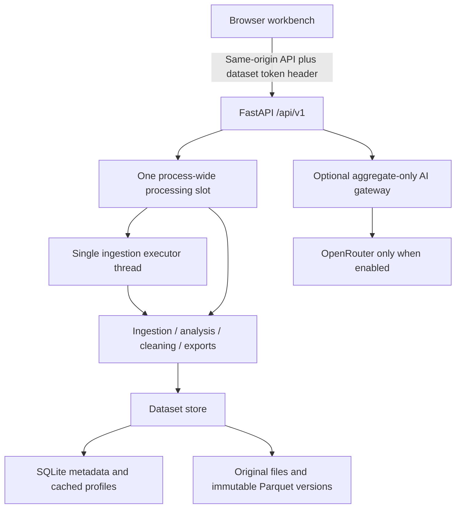

# Architecture

## Components



`backend/main.py` creates the application, HTTP limits, dataset authorization, routes, static-file serving, and cleanup lifecycle. Metadata, upload, profile and job responses use Pydantic response validation. `config.py` validates environment settings. `store.py` owns filesystem snapshots, capabilities, capacity, previews and version history. `database.py` stores relational metadata. `jobs.py` serializes ingestion. Engine and UI interfaces are defined in [API_CONTRACT.md](API_CONTRACT.md). The parent verified the final regression: 395 Python tests in 12.05 seconds, clean Ruff checks, npm build/check and all 6 real-backend Chromium tests in 25.4 seconds. A synthetic benchmark completed. Independent bounded core and engines/frontend/container-configuration reviews reported no vulnerabilities; this is not certification. See [VALIDATION.md](VALIDATION.md).

The frontend build generates `frontend/styles.css` and local `frontend/vendor/` assets; the remaining browser modules are served directly. FastAPI serves `/` and `/static`. Docker uses Node 22 for building assets, then Python 3.12 for runtime. Node, source documentation, private environment files and PDFs are not part of the runtime image.

## Dataset lifecycle and authorization

1. Upload or select a synthetic sample. The server inspects the input and creates a new dataset with its own random capability token, returning the token once.
2. Retain that token privately and send it as `X-Session-Token` on **every request for that dataset**, including job polling and downloads. A different dataset requires its own token. SQLite holds a SHA-256 token hash, not the token.
3. Ingest with explicit options. A job creates baseline version 0 only after a successful import and deadline/publication checks. Stable internal row IDs live in the DataFrame index named `__row_id__`, not a user data column.
4. Retrieve profiles, inspect recommendations, preview a specific operation, then approve its server-held preview using the current version and revision.
5. Export before expiry or explicitly delete the dataset. There are no permanent accounts, password recovery or durable session recovery.

Missing/invalid capabilities deliberately return 404; expired valid sessions return 410. Dataset IDs alone do not authorize access. Tokens must never appear in URL parameters or public links.

## Concurrency and cooperative deadlines

Exactly one Uvicorn worker and one service instance are supported. A process-local bounded semaphore guards heavy work. Ingestion uses `ThreadPoolExecutor(max_workers=1)` and holds that same slot from submission through worker exit; contenders fail promptly with 429 rather than building an unbounded processing queue. Small metadata/job requests can still be served.

The ingestion deadline uses a monotonic clock and is checked before baseline publication. It **cannot kill a running Python parsing thread**. Consequently:

- Passing the timeout does not mean the worker stopped or its memory was released.
- The job may remain `running` until the worker returns and the deadline is checked.
- The processing slot remains held until the thread exits, even past the deadline.
- An over-deadline baseline is removed and is not published as an active version.
- Shutdown can wait for the running worker. A hard wall-clock kill would require an isolated process design, which is not implemented.

Do not increase Uvicorn workers or replicas: the semaphore, AI gateway state and request limiter are process-local, and SQLite/WAL alone does not provide distributed orchestration.

## Storage and cache

Default layout:

```text
storage/
  metadata.sqlite3
  sessions/<dataset-uuid>/
    original/source.csv or source.xlsx
    snapshots/v0.parquet, v1.parquet, ...
    reports/
```

The store retains the original bytes read-only and writes snapshots through a pending file before atomic rename. Metadata transactions publish a version; failure removes an unpublished snapshot. Per-dataset/version profiles, issues and recommendations are cached in SQLite and reused for subsequent requests. Restoring a version can reuse its existing analysis cache. These caches may include sensitive data and expire with the dataset.

Application caps cover uploads, dimensions, sessions, versions and storage; they are not a guarantee of bounded peak RAM or protection against all malicious inputs. Metadata/caches and filesystem overhead also consume storage. Default expiry is fixed at creation plus 60 minutes, not an account lifetime. Cleanup runs on startup and periodically (approximately every 60 seconds), skips a busy processing slot, and also runs during creation. Expired data may remain on disk until cleanup can run. Delete removes metadata and files; it is not secure erasure.

Storage is temporary by product design and ephemeral on Render. Restarts on a retained local directory may retain unexpired files, but queued/running jobs are marked failed on database initialization rather than resumed. Free-host restarts/spin-down/redeploys lose the whole local state.

## Version graph, not a linear rewrite log

Each immutable version records a `parent`, operation and creation time. A dataset has an active version plus a monotonically increasing revision. New changes allocate a fresh version ID using the maximum existing version; they do not overwrite descendants.

For example, after `0 → 1 → 2`, undoing to 1 and applying another operation produces version 3 with parent 1. Version 2 remains explicitly restorable, although the redo stack is cleared. Undo follows parent pointers; redo follows the current navigation stack. Reset activates version 0; restore activates an existing requested version. Neither operation deletes history. Navigation increments the revision and invalidates previews. Generated reference code follows only the active version's ancestor chain, not abandoned branches.

Previews expire after ten minutes and only the latest preview for a dataset is retained. Apply accepts a preview ID, explicit approval, expected version and expected revision; it uses the stored operation rather than accepting an unreviewed replacement. Stale state yields 409. The version cap requires exporting and starting a fresh dataset rather than silently pruning history.

## Optional AI boundary

Deterministic analysis is the primary path. Optional AI receives a restricted aggregate summary, never raw rows, example cells, filenames or column names. It must not run transformations, execute returned code or bypass approval. Provider access is disabled in the public deployment blueprint. Aggregate transmission is still disclosure and needs informed operator consent. See [security](../SECURITY.md) for the boundary and [deployment](../DEPLOYMENT.md) for limitations.
